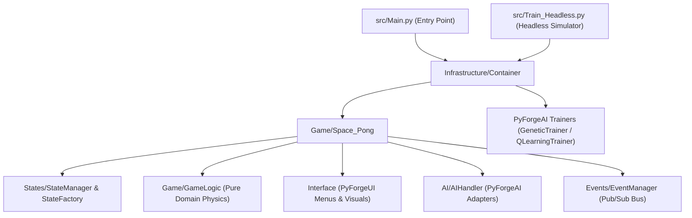

# Space Pong AI (`Pong_Game`)

[](https://deepwiki.com/Drakonosinc/Pong_Game)
[](https://www.python.org/)
[](https://pyga.me/)
[](https://pypi.org/project/pyforgeui/)
[](https://pypi.org/project/pyforgeai-engine/)
[](https://www.gnu.org/licenses/gpl-3.0.html)

**Space Pong AI** is a space-themed arcade Pong game and interactive AI laboratory built with **Pygame-CE**, **[PyForgeUI](https://github.com/Drakonosinc/PyForgeUI)**, and **[PyForgeAI](https://github.com/Drakonosinc/PyForgeAI)**. Designed around an event-driven Clean Architecture (`EventManager`, `StateManager`, and `GameLogic` decoupled from rendering), it allows you to play locally, challenge pre-trained neural networks, or train new agents in real time (or headless high-speed mode) using **Neuroevolution (Genetic Algorithms)** and **Deep Q-Learning (DQN)**.

---

## Features

- **Three Interactive Game Modes**:
  - **One Vs One (`Player`)**: Local multiplayer with customizable keybindings, ball count, paddle speeds, and win conditions.
  - **One Vs AI (`AI`)**: Challenge a trained neural network loaded asynchronously in the background via `AILoader`.
  - **Training AI (`Training AI`)**: Train an AI agent live on screen with adjustable simulation speed, or run mathematical generations without frame limits using `Train_Headless.py`.
- **Powered by `PyForgeAI` (`pyforgeai-engine`)**:
  - **Training Strategies**: Switch between **Genetic Algorithms** (population size, generations, trials per genome) and **Deep Q-Learning / DQN** (episodes, learning rate $\alpha$, discount factor $\gamma$, $\epsilon$-greedy decay).
  - **Multi-Backend Neural Networks**: Supports both **PyTorch** and **TensorFlow** backends with customizable hidden layers and neurons per layer directly from the in-game AI menu.
  - **Real-Time Neural HUD**: Live on-screen rendering of normalized hidden-layer neuron activations and synaptic weight previews during AI matches and training.
- **Powered by `PyForgeUI` (`pyforgeui`)**:
  - Multi-screen interface (`Main Menu`, `Game Mode`, `AI Configuration`, `Options`, `Visuals Customizer`, `Keybindings`, `Pause`, and `Game Over`) built with `ElementsFactory` widgets (`TextButton`, `PolygonButton`, `InputText`, `ScrollBar`, `ComboBox`).
- **Event-Driven Clean Architecture**:
  - Pure domain physics and collision engine (`GameLogic`, `Rectangle`, `WorldStateDTO`) completely decoupled from `pygame` rendering, enabling deterministic headless simulation and unit testing.

---

## Architecture



---

## Installation

1. Clone the repository:
   ```bash
   git clone https://github.com/Drakonosinc/Pong_Game.git
   cd Pong_Game
   ```

2. Install the required dependencies (including `pyforgeui` and `pyforgeai-engine` from PyPI):
   ```bash
   pip install -r requirements.txt
   ```
   *(Optional)* Install TensorFlow if you wish to switch the neural network backend from PyTorch to TensorFlow in the AI menu:
   ```bash
   pip install tensorflow
   ```

---

## Usage

### 1. Run the Game (Full Graphical Interface)
```bash
python src/Main.py
```

### 2. Run High-Speed Headless AI Training (No Rendering Overhead)
Trains the agent using the active configuration in `Config/ai_config.json` at maximum CPU/GPU speed without window or frame-rate limits:
```bash
python src/Train_Headless.py
```

### 3. Run the Automated Test Suite (81 Unit & Integration Tests)
```bash
python run_tests.py
```

---

## Default Controls

| Action | Default Key |
| :--- | :--- |
| **Player 1 Move Up / Down** | `W` / `S` |
| **Player 2 Move Up / Down** | `Up Arrow` / `Down Arrow` |
| **Pause / Resume Game** | `P` / `Space` |
| **Increase / Decrease Simulation Speed** | `Right Arrow` / `Left Arrow` (or `+` / `-`) |
| **Save Current AI Model** | `1` |
| **Toggle Fullscreen** | `F11` |
| **Exit to Menu / Quit** | `ESC` |

*(All controls, visual themes, spacecraft sprites, planets, resolution, and AI hyperparameters can be customized directly from the in-game menus and are persisted in `Config/*.json`).*

---

## Project Structure

```text
Pong_Game/
├── AI/                     # Saved neural network checkpoints (best_model.pth)
├── Config/                 # Persistent JSON settings (ai_config, keybindings, settings, visuals)
├── Fonts/                  # Retro arcade typography
├── images/                 # Spacecraft, planet, and space background sprites
├── sounds/                 # Sound effects and background music
├── src/
│   ├── AI/                 # AIHandler bridging GameStateChangedEvent with PyForgeAI adapters
│   ├── Core/               # GameContext, AssetManager, WindowManager, Domain DTOs & Geometry
│   ├── Entities/           # Player paddles and Ball physics entities
│   ├── Events/             # EventManager pub/sub bus, GameEvents, and InputHandler
│   ├── Game/               # Space_Pong application coordinator and pure GameLogic engine
│   ├── Infrastructure/     # DI Container, PygameAudioService, and PyForgeAI TrainingAdapters
│   ├── Interface/          # PyForgeUI menus, HUD overlays, and live neural network visualizer
│   ├── Loaders/            # JSON Config_Loader and PyForgeAI model loader exports
│   ├── States/             # State pattern implementation (Menu, ModeSelect, Playing, Pause, etc.)
│   ├── Main.py             # Graphical game entry point
│   └── Train_Headless.py   # High-performance headless training runner
├── tests/                  # 81 unit and integration tests
├── requirements.txt
└── run_tests.py            # Automated headless test suite runner
```

---

## License

This project is licensed under the [GNU GPL v3.0](https://www.gnu.org/licenses/gpl-3.0.html).

## Author

Developed by [Drakonosinc](https://github.com/Drakonosinc)
